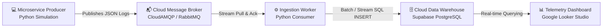

# ☁️ Cloud-Native Real-Time Log Analyzer & Telemetry Pipeline

> An event-driven, decoupled telemetry pipeline that ingests distributed system logs, buffers events in a cloud message queue, stores them in a cloud data warehouse, and visualizes server health in real time.

---

## 📌 Architecture Overview



### Ingestion Pipeline Breakdown:
1. **Log Producer (`producer.py`)**: Simulates microservice traffic (`auth-service`, `payment-service`, `order-service`, `user-service`) generating structured JSON log events across different endpoints and severity levels (`INFO`, `WARNING`, `ERROR`).
2. **Message Broker (CloudAMQP / RabbitMQ)**: Decouples the application layer from the database. Acts as a high-throughput buffer preventing database connection exhaustion during traffic spikes.
3. **Stream Ingestion Worker (`consumer.py`)**: Pulls messages asynchronously from the queue, validates the schema, inserts rows into the data warehouse, and acknowledges message processing (`basic_ack`).
4. **Cloud Data Warehouse (Supabase PostgreSQL)**: Stores structured log entries with indexed fields for high-performance analytical queries.
5. **Observability Dashboard (Google Looker Studio)**: Visualizes key Site Reliability Engineering (SRE) metrics like throughput, failure rates, HTTP code distribution, and service latency.

---

## 🚀 Key SRE Telemetry Metrics Tracked

| Metric | Calculation | Purpose |
| :--- | :--- | :--- |
| **Throughput** | `COUNT(*)` | Total logs ingested across all microservices |
| **Error Volume** | `COUNT(log_level = 'ERROR')` | Count of critical failures & HTTP 500/503 |
| **Error Rate %** | `(Errors / Total Logs) * 100` | Health indicator for service stability |
| **Average Latency** | `AVG(response_time_ms)` | Detects degraded microservices and slow queries |
| **Status Code Mix** | Grouped by `status_code` | Ratio of 200 (Success) vs 404 (Not Found) vs 500 (Server Error) |
| **Endpoint Heatmap** | `AVG(latency) GROUP BY endpoint` | Identifies bottleneck routes (e.g. `/api/checkout`) |

---

## 🛠️ Tech Stack

- **Language:** Python 3.x
- **Message Broker:** CloudAMQP (RabbitMQ, AMQP Protocol)
- **Data Warehouse:** Supabase (Cloud PostgreSQL 16)
- **Visualization:** Google Looker Studio
- **Libraries:** `pika`, `psycopg2-binary`

---

## 📁 Repository Structure

```
├── producer.py          # Simulates traffic & publishes logs to CloudAMQP
├── consumer.py          # Ingestion worker: streams logs to Supabase
├── schema.sql           # Database schema & analytical query templates
├── requirements.txt     # Python dependencies
├── .env.example         # Template for environment variables (credentials)
├── .gitignore           # Ignores sensitive keys & virtual environment files
└── README.md            # Project documentation
```

---

## ⚙️ Quickstart & Local Setup

### 1. Clone the Repository
```bash
git clone https://github.com/<YOUR_GITHUB_USERNAME>/<REPO_NAME>.git
cd <REPO_NAME>
```

### 2. Install Dependencies
```bash
pip install -r requirements.txt
```

### 3. Configure Environment Variables
Copy `.env.example` to `.env` and fill in your CloudAMQP URL and Supabase connection credentials:
```bash
cp .env.example .env
```
Inside `.env`:
```env
CLOUDAMQP_URL=amqps://<username>:<password>@<host>/<vhost>
DB_HOST=aws-0-ap-south-1.pooler.supabase.com
DB_PORT=6543
DB_NAME=postgres
DB_USER=postgres.<project_ref>
DB_PASSWORD=your_supabase_password
```

### 4. Initialize Database Schema
Run the SQL queries in `schema.sql` inside your **Supabase SQL Editor** to create the `server_logs` table and performance indexes.

---

## 🏃 Running the Pipeline

Open **two terminal windows**:

### Terminal 1: Start Ingestion Consumer
```bash
python consumer.py
```
*Output: `⚙️ Ingestion Worker started: Waiting for logs in queue...`*

### Terminal 2: Start Log Producer
```bash
python producer.py
```
*Output: `Sent: [INFO] payment-service -> /api/checkout (200)`*

---

## 📊 Connecting to Google Looker Studio

1. Open [Google Looker Studio](https://lookerstudio.google.com/) and create a **Blank Report**.
2. Add a new Data Source using the **PostgreSQL** connector.
3. Provide your Supabase database host, port (`6543`), database name (`postgres`), user, and password.
4. Select table `server_logs`.
5. Add Scorecards, Time Series charts, and Pie charts to visualize your live metrics!

---

## 🎓 Cloud Computing Concepts Demonstrated

- **Decoupled Architecture:** Asynchronous Producer-Consumer pattern using message queuing.
- **Load Leveling & Buffering:** Ingestion queue absorbs sudden surges in microservice traffic.
- **Serverless & Managed Cloud Services:** Leveraging DBaaS (Supabase) and Message Broker as a Service (CloudAMQP).
- **At-Least-Once Delivery:** Explicit message acknowledgments (`basic_ack`) prevent data loss during transient network partitions.

---

## 👤 Author
- **Sangram Jadhav**
- Course: Cloud Computing Mini-Project
